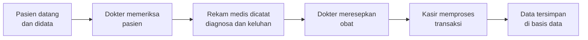
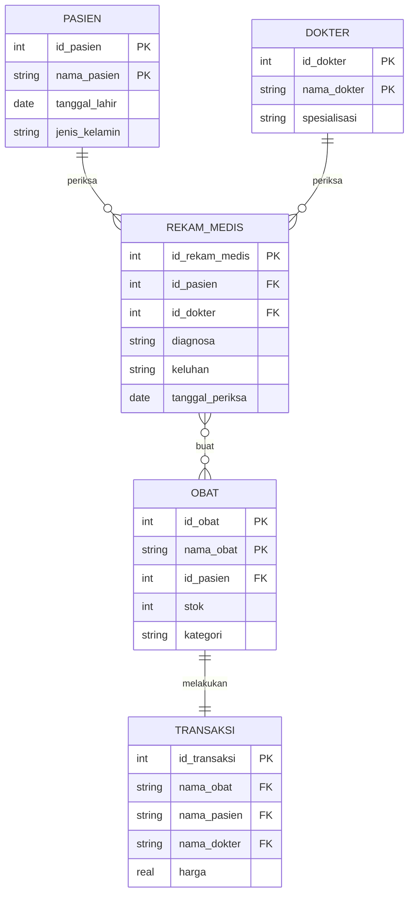

# Dokumentasi Sistem Informasi Pelayanan Klinik

Repository ini berisi dokumentasi tugas mata kuliah **Sistem Informasi** untuk studi kasus **Sistem Informasi Pelayanan Klinik**, yang dikelola menggunakan GitHub sebagai layanan cloud untuk penyimpanan, kolaborasi, dan version control dokumen.

| | |
|---|---|
| **Mata Kuliah** | Sistem Informasi |
| **Kode Mata Kuliah** | MKDK2658302102 |
| **Semester / Kelas** | 1 B TRPL |
| **Dosen Pengampu** | Dr. Putu Desiana Wulanin Ayu, S.T., M.T. |
| **Kelompok** | 7 |

---

## Navigasi

- [Tujuan Sistem](#tujuan-sistem)
- [Struktur Folder](#struktur-folder)
- [Cara Kerja Sistem](#cara-kerja-sistem)
- [ERD (Entity Relationship Diagram)](#erd-entity-relationship-diagram)
- [Identitas Kelompok](#identitas-kelompok)
---

## Tujuan Sistem

Sistem Informasi Pelayanan Klinik bertujuan untuk:

1. Mengelola data pasien, dokter, rekam medis, obat, dan transaksi secara **terpusat** dan terstruktur.
2. Mengurangi pencatatan manual yang rawan hilang, rusak, atau salah input.
3. Membantu dokter melihat **riwayat pemeriksaan** pasien sebagai referensi pemeriksaan dan peresepan obat berikutnya.
4. Mempercepat proses administrasi dan pembayaran di kasir.
5. Menyediakan informasi yang akurat, konsisten, dan mudah diakses oleh pengguna yang berwenang.

---

## Struktur Folder

```
.
├── README.md
├── Dokumentasi/
└── ERD/
```

| Folder | Isi |
|---|---|
| `Dokumentasi/` | Dokumentasi dari Sistem Informasi Pelayanan Klinik (Berdasarkan tugas yang telah diberikan sebelumnya ) |
| `ERD/` | Gambar dan berkas diagram ERD Sistem Informasi Pelayanan Klinik |

---

## Cara Kerja Sistem

Sistem melibatkan tiga peran utama: **Pasien**, **Dokter**, dan **Kasir**.



**Alur kerja:**

1. **Pendataan pasien.** Data pasien (nama, tanggal lahir, jenis kelamin, alamat, no. telepon) dicatat di tabel `PASIEN`.
2. **Pemeriksaan.** Dokter (`DOKTER`) memeriksa pasien dan mencatat hasilnya di tabel `REKAM_MEDIS` (diagnosa, keluhan, tanggal periksa). Rekam medis terhubung ke pasien dan dokter melalui *foreign key* `id_pasien` dan `id_dokter`.
3. **Peresepan obat.** Dokter meresepkan satu atau lebih obat dari tabel `OBAT` (nama obat, kategori, stok). Dokter juga dapat melihat rekam medis sebelumnya sebagai referensi.
4. **Transaksi.** Kasir mengambil data dari tabel-tabel sebelumnya (nama pasien, nama dokter, nama obat) untuk mencatat `TRANSAKSI` beserta harganya, lalu mencetaknya.

**Relasi antar tabel:**

| Relasi | Jenis | Penjelasan |
|---|---|---|
| `PASIEN` ke `REKAM_MEDIS` (**periksa**) | One to Many | Satu pasien dapat memiliki banyak rekam medis; satu rekam medis hanya milik satu pasien |
| `DOKTER` ke `REKAM_MEDIS` (**periksa**) | One to Many | Satu dokter dapat menangani banyak rekam medis; satu rekam medis hanya ditangani satu dokter |
| `REKAM_MEDIS` ke `OBAT` (**buat**) | Many to Many | Satu rekam medis dapat memuat banyak obat; satu jenis obat dapat muncul di banyak rekam medis |
| `OBAT` ke `TRANSAKSI` (**melakukan**) | One to One | Satu data obat terhubung ke satu data transaksi |

---

## ERD (Entity Relationship Diagram)

Diagram berikut dirender otomatis oleh GitHub:



Versi gambar ERD juga tersedia di folder [`ERD/`](./ERD).

---

## Identitas Kelompok

**Kelompok 7, Kelas 1 B TRPL**

| No | Nama | NIM | Profil |
|---|---|---|---|
| 1 | Ranggah Rajasa Rudiwangsa | 2615354022 | [Lihat](#1-ranggah-rajasa-rudiwangsa) |
| 2 | Muhammad Izzat Bashay | 2615354006 | [Lihat](#2-muhammad-izzat-bashay) |
| 3 | Alfathar Farrelinoputra | 2615354050 | [Lihat](#3-alfathar-farrelinoputra) |
| 4 | I Gusti Rai Panudrakarna | 2615354034 | [Lihat](#4-i-gusti-rai-panudrakarna) |

### 1. Ranggah Rajasa Rudiwangsa

- **NIM:** 2615354022
- **Program Studi / Kelas:** 1 B TRPL
- **GitHub:** [@ranggahrajasa](https://github.com/ranggahrajasa)

[Kembali ke Navigasi](#navigasi)

### 2. Muhammad Izzat Bashay

- **NIM:** 2615354006
- **Program Studi / Kelas:** 1 B TRPL
- **GitHub:** [@muhmdbashay-lang](https://github.com/muhmdbashay-lang)

[Kembali ke Navigasi](#navigasi)

### 3. Alfathar Farrelinoputra

- **NIM:** 2615354050
- **Program Studi / Kelas:** 1 B TRPL
- **GitHub:** [@y7zsora](https://github.com/y7zsora)

[Kembali ke Navigasi](#navigasi)

### 4. I Gusti Rai Panudrakarna

- **NIM:** 2615354034
- **Program Studi / Kelas:** 1 B TRPL
- **GitHub:** [@raipaundraa-ai](https://github.com/raipaundraa-ai)

[Kembali ke Navigasi](#navigasi)

---
